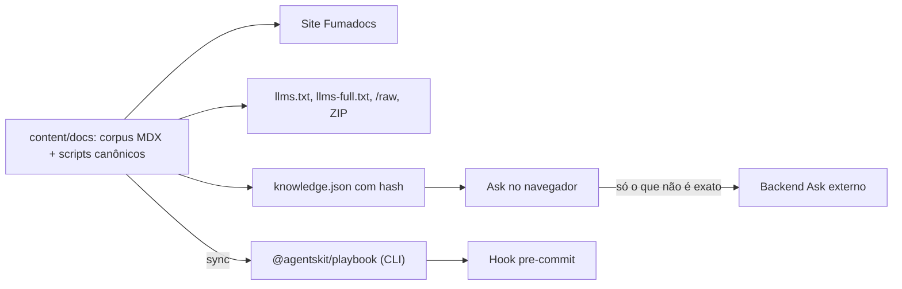

# 00 Hub - agents-playbook

> [!tldr] Em linguagem comum
> É o manual de engenharia aberto da AgentsKit para trabalhar com agentes de IA que escrevem código: regras, prompts, modelos de documento e verificações automáticas. Publica tudo como site (playbook.agentskit.io), como texto pronto para IA e como um pacote npm que roda as verificações em qualquer projeto.

← [[Camada - Ferramentas]]

## Para que existe e quem usa

Repositório **público**: código MIT e corpus editorial CC BY 4.0 (`lib/shell.ts:17`, `README.md:13`, `README.md:14`). O app raiz tem `private: true` só para não ir ao npm (`package.json:4`). Stack: Next 15, React 19, Fumadocs 15, Tailwind 4, Zod 4, Node 22, pnpm 10 (`package.json:45` a `:77`).

| Público | Uso |
|---|---|
| Times que adotam agentes de código | Ler pilares/fases, copiar templates (`AGENTS.md`, ADR, RFC) e prompts |
| Agentes de IA | `/llms.txt`, `/llms-full.txt`, `/raw/...`, `/for-agents`, artefato determinístico |
| Mantenedores de outros repos | Rodar gates com `npx @agentskit/playbook` ou hook pre-commit |
| Outros sites do ecossistema | Consumir `/api/stats.json` |

## Partes

| Nota | Papel |
|---|---|
| [[agents-playbook-site]] | App Next/Fumadocs raiz: site, rotas para máquina, Ask local-first, artefatos de build |
| [[playbook]] | `@agentskit/playbook` 0.1.1: CLI com 12 gates, zero dependências; único workspace de `packages/*` (`pnpm-workspace.yaml:2`) |

## Fluxos

| Nota | O que mostra |
|---|---|
| [[Playbook - Do corpus à consulta]] | Do Markdown ao site, aos arquivos para IA e à resposta do Ask |
| [[Playbook - Da regra ao gate executável]] | Do script canônico ao pacote npm, à CLI e ao pre-commit |

## Guias

| Nota | Quando |
|---|---|
| [[Playbook - Validar uma mudança]] | Antes de qualquer PR |
| [[Playbook - Adicionar um padrão ao corpus]] | Novo documento em `content/docs` |
| [[Playbook - Adicionar ou alterar um gate]] | Mudar/criar uma verificação |
| [[Playbook - Implantar o site e empacotar a CLI]] | Deploy e publicação |

## Decisões

O repo **não tem ADRs próprios** (não existe `docs/adr/`); por isso não há pasta `decisões/`. O corpus *ensina* ADR/RFC (`content/docs/pillars/architecture/adr-pattern.md`, templates em `content/docs/templates/`), mas as decisões do próprio repo ficam em PRs, `CHANGELOG.md` e `GOVERNANCE.md` (`GOVERNANCE.md:9` a `:17`).

Auditoria das notas v1: [[Auditoria - agents-playbook]].

## Como se liga ao ecossistema

| Vizinho | Relação | Evidência |
|---|---|---|
| [[00 Hub - agentskit-chat]] | Runtime do Ask: `@agentskit/chat` 0.4.1 exato ([[chat]], [[chat-protocol]]) | `package.json:45` |
| [[00 Hub - agentskit]] | `@agentskit/core` e `@agentskit/react` no Ask; `@agentskit/cross-platform` nos scripts; serviço Ask padrão; shell visual v1 em `www.agentskit.io` | `package.json:46`, `package.json:47`, `package.json:59`, `lib/shell.ts:6` |
| [[00 Hub - doc-bridge]] | devDependency 1.12.0: índice, query, gate, doctor, conformance; Action de advisory 2.0.0 em PRs | `package.json:60`, `.github/workflows/doc-bridge-advisory.yml:20` |
| [[00 Hub - harness]] | devDependency `@agentskit/harness`: `harness:doctor`/`harness:verify` | `package.json:20`, `package.json:61` |
| [[00 Hub - .github]] | Workflows reutilizáveis CodeQL, Scorecard, dependency-review e audit fixados no SHA `e921ea2` | `.github/workflows/codeql.yml:22`, `.github/workflows/scorecard.yml:16`, `.github/workflows/dependency-review.yml:45`, `.github/workflows/dependency-review.yml:52` |
| [[00 Hub - code-review]], [[00 Hub - agentskit-registry]] | Só links editoriais/navegação (`ecosystem.json`, entradas fixas do Ask); sem import | `ecosystem.json:8` |
| [[00 Hub - ecosystem-distribution-ops]] | Divulga os gates npm (segundo o hub dele); sem import | — |

## Dados, deploy e CI

- **Dados**: só corpus (`content/docs`) e artefatos derivados (`app/stats.snapshot.json`, `public/deterministic/*`, ZIP, índice raw). Sem banco, sem segredo de servidor; variáveis só `NEXT_PUBLIC_*` (detalhes em [[agents-playbook-site]]). Ver [[Onde ficam os dados]].
- **Deploy**: Cloudflare Workers via OpenNext (`wrangler.jsonc:5`, teto de CPU 5 s em `wrangler.jsonc:15`) e Vercel (`vercel.json:15`). Nenhum workflow de deploy ou de `npm publish` no repo. Ver [[Infra e deploy]].
- **CI** (`.github/workflows/ci.yml`): `quality` (Ubuntu: OKF, config e índice doc-bridge sem diff, gate, conformance, README Standard, testes, lint/tipos, build, frescor dos gerados; `.github/workflows/ci.yml:17`), `browser` (Playwright, pulado para Dependabot; `.github/workflows/ci.yml:43`), `playbook-package` (Ubuntu/macOS/Windows; `.github/workflows/ci.yml:59`). Mais: advisory doc-bridge em PR (`pull-requests: write`), CodeQL semanal, Scorecard, dependency-review + `pnpm audit` crítico de produção (`.github/workflows/dependency-review.yml:56`).
- **Doc-bridge**: `doc-bridge.config.json` é gerado por script e tem 142 rotas de ownership — todas apontam para documentos ou arquivos de infraestrutura; o código do app e o pacote não têm rota (`scripts/generate-doc-bridge-config.mjs:29`). O handoff do repo (`docs/for-agents/INDEX.md:5` a `:8`) manda editar em `content/docs` e validar com `pnpm check:all`.

> [!warning] Divergências encontradas (detalhe em [[Auditoria - agents-playbook]])
> - `README.md:16` anuncia Doc Bridge 100/100 A; nesta checagem, `ak-docs doctor` deu 79/100 B e `pnpm check:doc-bridge-score` falhou. A CI não roda esse script.
> - `README.md:45` pede pnpm 9; `package.json:75` fixa pnpm 10.34.4; `vercel.json:15` usa pnpm 9.15.4.
> - `ECOSYSTEM-COHESION.md:3` fala em sete produtos, mas a tabela lista seis (sem Harness) e cita `ecosystem-bar.js` (`ECOSYSTEM-COHESION.md:26`), enquanto o código carrega `shell/v1.js` (`lib/shell.ts:9`).

> [!info]- Detalhe técnico
> - Ownership declarado do host vs. Chat: `AGENTS.md:5` a `:9`.
> - Comandos de roteamento: `AGENTS.md:16` a `:18`; MCP `ak-docs mcp`: `AGENTS.md:21`.
> - Script agregado: `package.json:42` (`check:all`).
> - Overrides de segurança de dependências: `pnpm-workspace.yaml:4`.
> - Entrada do Playbook no catálogo do ecossistema com `showInBar: false`: `ecosystem.json:211`.
